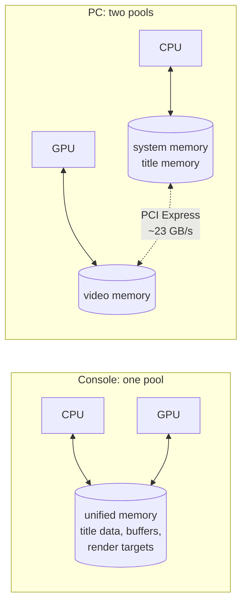
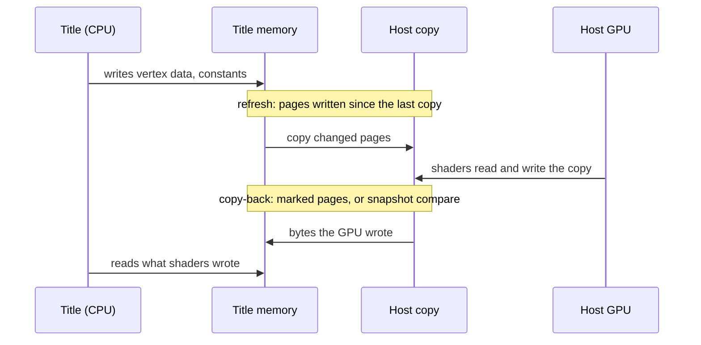
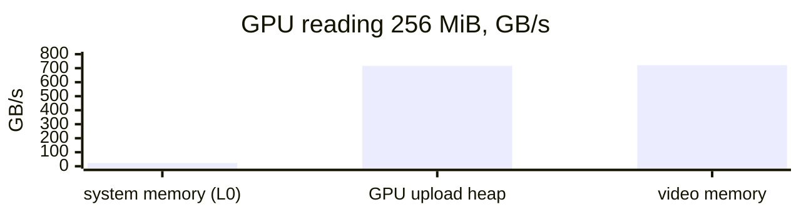
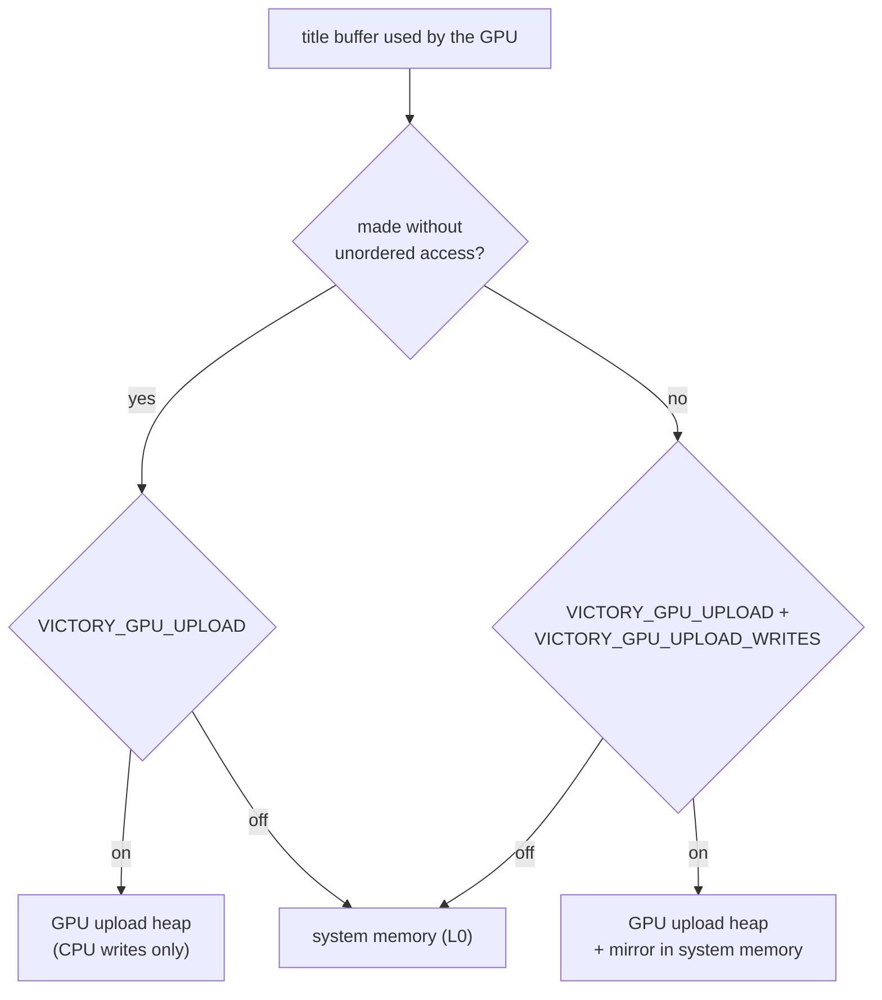
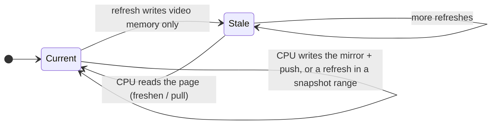
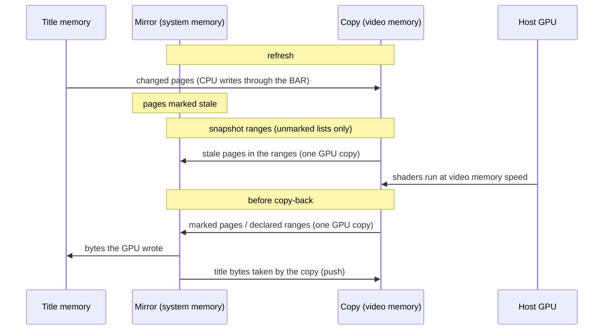
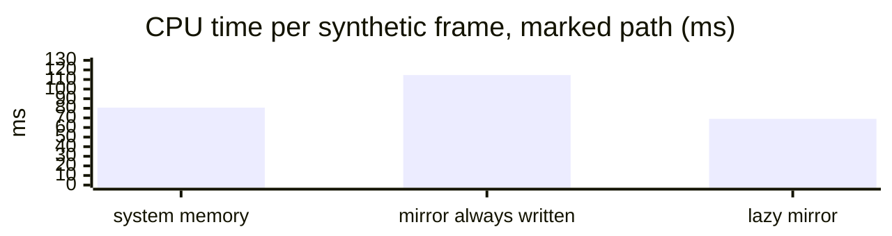

# GPU memory: bridging unified and split memory

An Xbox Series console has one pool of memory. The CPU and the GPU read
and write the same bytes at the same addresses, and a title is written
for that: it builds vertex data, constants and command buffers in place,
hands the GPU their addresses, and reads back what shaders wrote, all
without copying anything.

A desktop PC (Apple silicon and integrated GPUs aside) has two pools:
system memory next to the CPU and video memory on the graphics card,
joined by PCI Express. Each processor is fast in its own pool and slow in
the other one. This page covers how `victory-gpu` bridges the two, what
each choice costs, and the switches that move data closer to the GPU.

## Host copies of title memory

Title memory sits in system memory, at the addresses the title chose.
The host GPU cannot use those addresses, so every title buffer a draw or
dispatch uses gets a **host copy** (`crate::shadow::Shadow`): a D3D12
buffer of the same size. A title GPU address inside the buffer maps to
the same offset in its copy. Around each submission:

1. **Refresh.** Before the submission runs, the ranges it reads (vertex,
   index and constant data, buffer views, or everything a heap-indexing
   shader can reach) are brought up to date from title memory. Only the
   64 KiB pages the title wrote since the last copy are copied
   (`crate::watch` tracks them with write-watch and read-only guards).
2. **Run.** The host GPU reads and writes the copies.
3. **Copy-back.** What shaders wrote goes back into title memory, without
   overwriting what the title wrote in the meantime. There are two ways
   to find out what shaders wrote:
   - **Marked pages.** Translated shaders set a bit for each page they
     write through a buffer view (`victory_shader::emit`, "Write marks").
     Only those pages are compared with title memory.
   - **Snapshots.** For a range a list declares as written without marks,
     the copy's bytes are saved before the submission and compared after
     it. Whatever changed is what the GPU wrote.

## Where the copies live

By default every copy is in **system memory**, mapped write-back for the
CPU (`Host::shared_buffer`: a custom heap, `MEMORY_POOL_L0`). The CPU
writes and reads it at full speed, but every shader access crosses PCI
Express.

On a GPU with **Resizable BAR**, D3D12 also offers **GPU upload heaps**
(`D3D12_HEAP_TYPE_GPU_UPLOAD`, reported by
`D3D12_OPTIONS16.GPUUploadHeapSupported`). These are video memory that
the CPU can map and write through the BAR. Shaders access them at
video-memory speed. CPU writes stream across the bus at about the speed
of a system-memory write. CPU reads are uncached and very slow.

Measured on an RTX 5070 Ti (driver 621.24), Ryzen 9 7900X, Windows 11,
256 MiB at a time:

| | GPU reads | CPU writes | CPU reads |
|---|---|---|---|
| system memory (`L0`, the default for copies) | 22.9 GB/s | 28.7 GB/s | 22.7 GB/s |
| GPU upload heap (video memory through the BAR) | 716.8 GB/s | 22.7 GB/s | **0.05 GB/s** |
| video memory, default heap | 721.2 GB/s | (no CPU access) | (no CPU access) |

So a copy shaders use heavily belongs in video memory, but the CPU must
never read it there. Two opt-in switches act on that:

| switch | copies moved to a GPU upload heap | what the CPU reads |
|---|---|---|
| `VICTORY_GPU_UPLOAD=1` | buffers made without unordered access (shaders only read them) | nothing: the CPU only writes these copies |
| `VICTORY_GPU_UPLOAD_WRITES=1` (with the one above) | buffers shaders may write | a **mirror** in system memory |

Both switches fall back to system memory when the GPU has no GPU upload
heaps, and past a 2 GiB budget for these copies (`UPLOAD_BUDGET`; a copy's
bytes are given back when D3D12 destroys its buffer). Copies
of loose title memory and of single views (`loose`, `exact`) always stay
in system memory.

## Written copies: video memory with a lazy mirror

A copy that shaders write has to be read by the CPU: copy-back compares
it with title memory, and snapshots are taken from it. Reading it from
the upload heap at 50 MB/s is out of the question, so such a copy has two
parts:

- **the copy in video memory**, which shaders use and which always holds
  the current bytes;
- **the mirror** in system memory, which the CPU reads. It may be behind
  the copy in video memory, one 64 KiB page at a time.

The rules that keep them consistent:

- **Refreshes write video memory only** (`Shadow::copy`) and mark the
  pages they touched as stale in the mirror (a bit per page,
  `Vram::stale`). Writing the mirror as well would double the CPU's
  refresh cost, and on the marked path nothing ever reads those bytes.
- **Any other CPU write to the mirror goes on into video memory**
  (`Shadow::push`): copy-back taking the title's bytes, and the update of
  a snapshot under a busy range.
- **Before the CPU reads the mirror, its stale pages come back from video
  memory.** The GPU copies them (`Shadow::freshen` → `bring_back` →
  `Host::copy_now`: one command list, one fence wait, for any number of
  pages). The same goes for pages shaders wrote (`shadow::pull`): the
  marked pages before their copy-back, and the declared ranges with
  snapshots.
- **A submission's snapshots are prepared up front.** Before a
  submission, `Host::execute` collects the ranges its lists declare as
  written without marks (`shadow::snapshots_ahead`). Their stale pages
  come back in one GPU copy, and until the copy-backs, refreshes in those
  pages write the mirror as well. A snapshot then never waits for the
  GPU.
- **Page bits are cleared under the page lock, around the GPU copy.** A
  refresh that races the copy sets its bit again once the lock is
  released, so its bytes are not lost.

### What it costs and what it buys

On the GPU side, from the tests `reading_copies_in_video_and_system_memory`
and `written_copies_in_video_and_system_memory` (release, same machine):

| 256 MiB, one copy | system memory | video memory | |
|---|---|---|---|
| shader reads (read-only buffer) | 11.64 ms (23.1 GB/s) | 0.37 ms (722 GB/s) | 31× |
| shader reads and writes (written buffer) | 212.23 ms | 1.25 ms | 170× |

Bringing pages back costs a fixed 0.05 ms (a list and a fence wait),
plus the copy itself: 64 scattered pages (4 MiB) take 0.23 ms.

On the CPU side, a synthetic world frame (#1743's shape: a 174 MB heap,
36 submissions with 24 declared ranges each; median of three interleaved
runs, ms per frame):

| path | copies in system memory | written copies in video memory, mirror always written | lazy mirror (now) |
|---|---|---|---|
| marked pages | 80.7 | 114.6 | **69.0** |
| snapshots of declared ranges | 708 | 910 | 950 |

On the marked path the lazy mirror costs less CPU time than copies in
system memory. A refresh writes each changed page once, through the BAR,
where it used to write system memory, and only the pages shaders marked
come back. The snapshot path pays for bringing every declared range back
before its compare (several GB per frame here): it needs marks to
benefit.

## Measuring a title

The tests show the mechanism. Whether it pays off in a title depends on
how much of the title's GPU time goes to shaders reading these copies,
and that needs a run of the title. Compare `VICTORY_GPU_TIMING=1` with
and without the switches, together with the copy counters
(`--features diagnostics`).

## Further steps

- Size the budget from DXGI's video memory budget instead of a fixed
  2 GiB.
- Move copies between pools while running, according to how they are
  used (read-mostly, written by shaders, or read back by the CPU).
- Give snapshot ranges marks, or compare them on the GPU, so they no
  longer need their bytes brought back.
- Detile textures on the GPU, so their upload crosses the bus once,
  still tiled.
